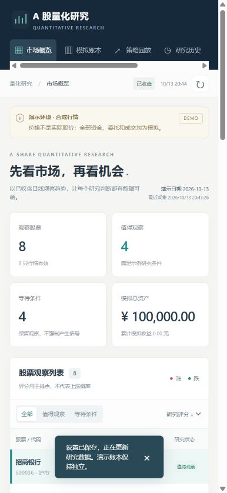
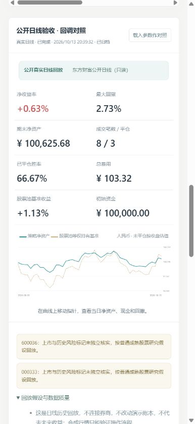

# A 股量化交易研究平台

基于 **Python + Vue 3 + TypeScript + Vite** 的 A 股量化交易研究与模拟平台，将股票池管理、指标分析、策略配置、历史回放和模拟账本连成一个可复查的研究流程。

当前支持研究分析和离线模拟，提供券商适配接口；**尚未连接券商实盘，未验证策略的实际盈利能力**。观察评分不是盈利概率，研究情景价不是预测必达价。



## 快速启动

需要 Python 3.12 或更新版本。仓库包含已构建的前端页面，直接运行不需要安装 Node.js，也不需要证券账户或密钥。

```sh
git clone https://github.com/djyking/ashare-observer.git
cd ashare-observer
python -m ashare_monitor
```

打开 <http://127.0.0.1:18766>。Windows 用户也可以双击项目根目录的 `打开A股观察台.cmd`；已有快捷入口名称保留，方便继续使用。服务仅监听本机地址。

首次启动使用可离线运行的合成行情。查看真实日线时，在“数据与设置”中选择公开行情。操作说明见 [使用指南](docs/使用指南.md)。

## 功能

- **行情与指标：** 股票代码/名称搜索、观察分组与模板、最多 50 只研究股票；日线图、EMA20/60、MACD、RSI、ATR、成交量比较与历史信号。
- **规则研究：** 教学趋势、上升回调、放量突破三类公开规则，支持开关和参数配置；逐项展示评分拆解、条件是否通过及价格情景，允许零信号。
- **独立数据模式：** 合成演示、公开已收盘日线、本地 CSV，显示日期、复权口径和来源错误。
- **CSV 导入：** 下载示例模板、上传后逐行校验、明确覆盖已有数据；数据保存在本机固定目录，校验失败不写入。
- **历史策略回放：** 独立选择股票池、日期、策略、仓位、费用、滑点和退出参数，后台运行并保存实验；展示权益曲线、收益、最大回撤、胜率、基准、成交和拒单，支持多实验对照。
- **模拟交易：** 提交前预览股数规则、费用、资金预留与 T+1 可卖数量；在下一交易日开盘撮合。新建实验会先归档旧账本，可随时回看。
- **持久化与历史：** SQLite 保存账本、设置、扫描明细、实验参数及研究输入数据标识；历史和交易记录每页 30 条、详情按需加载，重启不清空账本。
- **券商扩展接口：** 统一资金、持仓、委托、成交、下单和撤单契约。模拟适配器可用，实盘适配器未连接时明确拒绝操作。

<details>
<summary>查看历史回放报告示例</summary>



界面验收用研究报告，仅用于展示功能；小样本结果不能证明策略有效。

</details>

## 技术栈与结构

| 层 | 技术与用途 |
|---|---|
| 前端 | Vue 3、TypeScript、Vite；组件化看板、表单、图表和接口状态 |
| 后端 | Python 标准库；本机 HTTP、后台日线扫描、研究分析与模拟交易 |
| 持久化 | SQLite；账本、设置与扫描历史 |
| 测试 | Python unittest；前端测试、类型检查与生产构建 |
| 交付 | Vite 生成静态资源，由 Python 同源提供；无需常驻 Node 服务 |

```text
frontend/src/             Vue 页面、组件、类型和数据访问
        │ JSON HTTP
ashare_monitor/
  server.py              本机 HTTP 与前端静态资源
  runtime.py             采集调度、快照与账本操作
  data.py                日线来源与校验
  analysis.py            教学指标与观察规则
  strategies.py          三类公开策略与参数校验
  research.py            独立历史回放、权益与基准统计
  market_tools.py        股票搜索、分组模板、CSV 导入
  rules.py               A 股日历和市场规则
  portfolio.py           模拟委托、成交与账本
  brokers/               券商适配契约与模拟实现
  storage.py             SQLite 持久化、历史明细与实验归档
  web/                   已构建前端，可直接运行
tests/                   Python 单元和 HTTP 集成测试
docs/                    数据、规则、接口与使用说明
var/                     本机运行数据，不提交到仓库
```

前端源码位于 `frontend/`，`ashare_monitor/web/` 是可复现构建产物，在 GitHub 语言统计中标记为生成文件。框架及组件可直接从源码和依赖清单查看。

## 数据与模拟边界

| 模式 | 数据用途 | 手动演示账本 | 独立历史回放 |
|---|---|---|---|
| 离线演示 | 固定种子的合成日线，初始演示日期 2026-10-12 | 可用；推进演示交易日后撮合 | 可用，明确标注合成数据 |
| 公开日线 | 网络获取的已收盘历史行情，标明来源与复权口径 | 关闭 | 可用，需有效分析日线与原价日线 |
| 本地 CSV | 自行准备且有权使用的日线资料 | 关闭 | 可用，需声明原价或提供独立原价列 |

演示采用真实股票代码便于理解，但**演示股价、成交量、评分和收益全部是合成的，不代表真实市场表现**。演示时钟与电脑时间分开显示，推进交易日不是对未来行情的预测。公开行情和 CSV 模式显示的模拟账本仍使用独立演示行情计价，不混用资金或价格。

指标只使用截止日期之前的已收盘日线。公开行情分别读取复权分析序列与不复权价格；复权价格不能直接作为实盘委托价格。模拟委托最早在后续交易日开盘处理，不假设观察到收盘信号时已经在该收盘价成交。

初始模拟资金为 100,000 元。手动演示账本按开盘价模拟并扣费，**不额外模拟滑点**；独立历史回放支持配置费用和滑点。二者不共用仓位或资金，也不复现逐笔撮合、排队、盘口容量及全部公司行动。未提供杠杆、融资、做空或自动实盘执行功能。

历史回放使策略结果可以检查，但**实现回放工具不等于已证明策略有效**。当前股票池存在选择与幸存者偏差，公开复权数据不一定是历史当时可见的版本。公司行动、历史风险标记和数据缺口可能使结果失真；实验会标明假设、剔除和拒单原因。使用方法与限制见 [历史研究说明](docs/RESEARCH.md)。

交易日历覆盖 **2025—2026 年**，超出范围时拒绝模拟推进，需先更新官方日历。风险警示、新股或元数据不足等特殊股票只观察，不假设普通股票规则适用。细节见 [数据说明](docs/DATA.md) 与 [模拟规则](docs/SIMULATION_RULES.md)。

公开接口可能限流、延迟、变更或不可用。系统不以抓取时间冒充行情日期，也不使用演示数据填补真实数据空缺。本项目不提供交易所授权的实时行情服务；数据使用和再分发须遵守提供方条款。

## 券商接入

已提供可扩展接口，当前附带模拟实现和未连接的实盘占位实现。**适配接口不等于已经支持某家券商，也不会仅凭提供账号或密钥就开始真实交易。**

将来接入时需根据所选券商确认账户权限、接口费用、程序化交易管理要求及运行环境。尚未确定券商，因此不把“收费”作为未接入的既定原因。

开发者可参考 [券商适配指南](docs/BROKER_ADAPTER.md) 实现具体适配器。账户身份、密码、密钥与本地连接配置应保存在私有目录或环境变量中；仓库只放不含身份信息的示例。实盘启用及授权流程仍需在具体接入时实现并验证。

## 开发与验证

修改前端需要 **Node.js 22 LTS（22.12 或更新的 22.x 版本）** 和 npm。Python 后端仍仅使用标准库。

先在项目根目录启动 Python，再在另一终端运行：

```sh
cd frontend
npm ci
npm run dev
```

开发服务器通过代理访问本机 Python API；入口以 Vite 输出为准。开发服务用于本机开发，不应发布到公网。

运行检查和生成发布页面：

```sh
# 项目根目录：后端测试
python -m unittest discover -s tests -v

# frontend 目录：前端测试和类型检查、生产构建
cd frontend
npm ci
npm test
npm run build
```

修改前端后，请同时提交源码、依赖锁文件及更新后的 `ashare_monitor/web/` 构建产物，保证克隆即可启动。GitHub Actions 在 Windows 和 Ubuntu 上验证 Python 测试、前端测试、类型检查和构建一致性。实际验收结果见 [验收记录](docs/验收记录.md)。

数据库默认位于 `var/research.sqlite3`，CSV 默认位于 `var/imports`。扫描历史保留最近 2,000 次，模拟账本不随扫描历史清理。数据库、日志、导入数据、私有配置和依赖目录不应上传；提交前仍须检查暂存区，`.gitignore` 不能替代内容审查。

## 规则来源

- [上海证券交易所交易规则（2026 年修订）](https://www.sse.com.cn/lawandrules/sselawsrules2025/stocks/exchange/c/c_20260424_10816482.shtml)
- [2026 年休市安排](https://www.sse.com.cn/disclosure/announcement/general/c/c_20251222_10802507.shtml)
- [2025 年休市安排](https://www.sse.com.cn/disclosure/announcement/general/c/c_20241223_10767108.shtml)
- [北京证券交易所交易规则](https://www.bse.cn/jygl_list/200028217.html)
